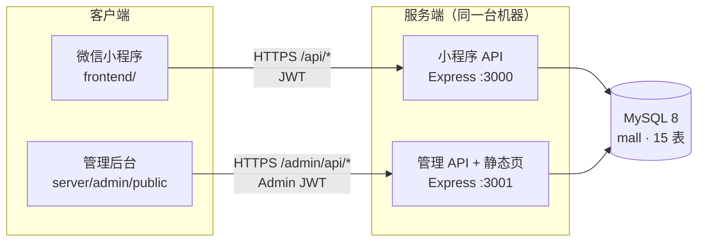

# 华为商城 · 微信小程序（wxapp）

> 一套**前后端分离**的电商小程序完整实现：原生微信小程序前端 + Express/MySQL 后端 + Vue 管理后台。
> 前端可**零后端独立运行**（本地 mock），也可以一条命令切到真实接口；后端自带建库、灌数、迁移、端到端测试脚本。

<p>
  
  
  
  
  
</p>

> ⚠️ **本项目为教学/演示用途**：商品数据、图片、支付流程均为模拟，未接入真实微信支付与真实商品库；
> 「华为」仅作为 UI 复刻对象，与华为技术有限公司无关。仓库内**不含任何真实密钥**，所有凭据通过 `.env` 注入。

---

## 目录

- [项目简介](#项目简介)
- [功能特性](#功能特性)
- [技术栈](#技术栈)
- [系统架构](#系统架构)
- [目录结构](#目录结构)
- [快速开始](#快速开始)
- [Mock / 真实后端切换](#mock--真实后端切换)
- [环境变量](#环境变量)
- [API 概览](#api-概览)
- [数据库设计](#数据库设计)
- [工程脚本](#工程脚本)
- [安全说明](#安全说明)
- [部署上线](#部署上线)
- [文档索引](#文档索引)
- [已知限制](#已知限制)

---

## 项目简介

本项目最初是一个 React H5 商城原型，后**1:1 转换为原生微信小程序**，并补齐了完整的后端与管理端，形成一条可跑通「浏览 → 加购 → 下单 → 支付 → 发货 → 收货」全链路的闭环。

设计上有两个关键取舍：

1. **前端可独立演示**：`frontend/` 内置 mock 数据与本地账号体系，不启动后端也能完整走完整个购物流程，方便面试演示 / 课堂讲解 / UI 走查。
2. **切换后端零改页面**：`services/api.js` 是唯一数据入口，mock 与真实接口**方法签名、返回契约完全一致**，页面与全局 store 无需感知差异，只改 `config.js` 一个开关。

---

## 功能特性

### 小程序端（C 端）

| 模块 | 能力 |
|---|---|
| 首页 | 轮播图、金刚区分类入口、精选/推荐商品流、下拉刷新 |
| 分类 | 左侧一级分类 + 右侧二级分类联动、商品网格、排序 |
| 商品详情 | 多图轮播、规格 SKU 选择、库存/销量展示、立即购买、加入购物车、收藏 |
| 购物车 | 勾选/全选、数量步进器、实时小计、失效商品过滤、结算 |
| 结算 | 收货地址选择、商品清单、运费/优惠字段（已就位）、提交订单 |
| 订单 | 订单列表（分状态筛选）、订单详情（商品快照 + 状态时间轴）、取消/确认收货 |
| 地址 | 新增/编辑/删除、默认地址、地区选择 |
| 账号 | 用户名密码注册登录（JWT）、静默登录恢复会话、退出登录 |
| 我的 | 用户信息、收藏、订单入口、设置项 |

交互细节：自定义导航栏 + 胶囊按钮避让、tabBar 本地图标、Toast/loading 统一封装、空状态占位。

### 管理后台（B 端，独立进程）

| 模块 | 能力 |
|---|---|
| 概览 | 商品数 / 订单数 / 用户数 / 销售额统计、最近订单 |
| 商品 | 列表、增删改、上下架、多图管理、SKU 与库存维护（事务提交） |
| 分类 | 一级/二级分类增删改、图标、启用状态 |
| 轮播 | 首页 banner 增删改、排序、启用 |
| 订单 | 订单列表、详情、发货（填写物流）、状态流转 |
| 用户 | 用户列表、禁用/启用 |
| 支付 | 支付流水查询 |

### 工程化

- 后端 **85 项**端到端断言（`npm run smoke`）、管理后台 **47 项**断言（`npm run smoke:admin`）
- 前端 3 个 Node 工具：全局状态回归、工程静态一致性校验、前后端联调校验
- 数据库全量建表 + **增量迁移**（保留已有数据）+ 幂等灌数脚本
- 一键起本地专用 MySQL 实例（端口 3307，不影响你机器上已有的 MySQL）

---

## 技术栈

| 层 | 选型 | 说明 |
|---|---|---|
| 小程序 | 原生 WXML/WXSS/JS（CommonJS） | 无框架、无构建，微信开发者工具直接打开 |
| 状态管理 | 自研发布/订阅单例（`store/shop.js`） | 轻量、无依赖，页面 `subscribe()` 自动刷新 |
| 后端 | Node.js ≥ 18 + Express 4 | CommonJS，`node --watch` 热重载 |
| 数据库 | MySQL 8（mysql2 连接池） | InnoDB + utf8mb4，15 张表，逻辑外键 |
| 鉴权 | JWT（jsonwebtoken） | 用户端与管理端**双密钥隔离** |
| 密码 | Node 内置 `crypto.scrypt` 加盐哈希 | 不存明文，格式 `scrypt$salt$hash` |
| 管理后台 | Vue 3（CDN 全量版）+ 原生 CSS | 单 HTML 页面，零构建 |
| 部署 | 1Panel + OpenResty + PM2 | 反代 + Let's Encrypt 自动证书 |

后端生产依赖仅 5 个：`express` / `mysql2` / `jsonwebtoken` / `cors` / `dotenv`。

---

## 系统架构



**数据流一条链**（以「首页加载商品」为例）：

```
home.js → shop.init() → api.fetchProducts()
        → wx.request(API_BASE_URL + '/products')
        → routes/products.js → db.query()
        → MySQL → serializers.productJSON()
        → JSON 回传 → store 更新 → notify() → setData 渲染
```

详细的数据流与表结构说明见 [数据库设计与数据流说明.md](./数据库设计与数据流说明.md)。

---

## 目录结构

```
wxapp/
├─ frontend/                        # 微信小程序（可独立运行，不依赖 server/）
│  ├─ app.js / app.json / app.wxss  # 全局入口、4 tab 注册、主题样式
│  ├─ project.config.json           # 开发者工具项目配置（appid 需自行替换）
│  ├─ assets/icons/                 # tabBar 本地 PNG（灰/红 × 4）
│  ├─ mock/                         # 本地演示数据：商品/分类/规格/用户
│  │  └─ specs.js                   # 多图 + 规格 SKU + 库存的确定性派生
│  ├─ services/
│  │  ├─ config.js                  # ★ 唯一的环境开关（mock / 接口地址）
│  │  ├─ api.js                     # ★ 唯一的数据入口（双模式同签名）
│  │  └─ storage.js                 # 本地持久化封装
│  ├─ store/shop.js                 # 全局状态单例（发布/订阅）
│  ├─ components/                   # icon / product-card / qty-stepper
│  ├─ pages/                        # 10 个页面
│  │  ├─ home  category  cart  profile        # 4 个 tab
│  │  ├─ product  checkout  address
│  │  └─ orders  order-detail  login
│  ├─ utils/                        # format 格式化 / nav 胶囊避让
│  └─ tools/                        # 工程脚本（不参与打包）
│
├─ server/                          # Express + MySQL 后端
│  ├─ .env.example                  # ★ 配置模板（复制为 .env）
│  ├─ src/
│  │  ├─ app.js                     # 小程序 API 入口
│  │  ├─ config.js  db.js           # 配置读取 / mysql2 连接池
│  │  ├─ middlewares/               # auth（JWT）/ error
│  │  ├─ models/                    # orders（状态机+库存）/ users
│  │  ├─ routes/                    # 10 个业务路由
│  │  └─ utils/                     # password / serializers / wechat
│  ├─ admin/                        # 管理后台（独立进程 :3001）
│  │  ├─ app.js  config.js
│  │  ├─ middlewares/admin-auth.js
│  │  ├─ routes/                    # dashboard/products/categories/banners/orders/users/payments
│  │  └─ public/index.html          # Vue 3 单页后台
│  ├─ sql/
│  │  ├─ schema.sql                 # 全量建表（15 张）
│  │  └─ migrations/                # 增量迁移（保留数据）
│  ├─ tools/                        # init-db / seed / smoke / mysql-local
│  ├─ README.md                     # 后端详细文档
│  └─ DEPLOY.md                     # 1Panel 部署手册
│
├─ 数据库设计与数据流说明.md          # 表结构 + 数据流详解
├─ 使用攻略.md                       # 手把手使用与踩坑指南
└─ .gitignore
```

---

## 快速开始

三种玩法，按需选一种。**推荐先用「零后端模式」跑通 UI**，再上后端。

### 方式一：只看 UI（30 秒，零依赖）

1. 打开**微信开发者工具** → 导入项目；
2. 目录选择 **`frontend/`**（注意不是仓库根目录）；
3. AppID 选「测试号」或填 `touristappid`；
4. 详情 → 本地设置 → 勾选 **不校验合法域名、web-view、TLS 版本以及 HTTPS 证书**；
5. 编译，底部 4 个 Tab 即可浏览。

此时走本地 mock 数据（`frontend/services/config.js` 中 `MANUAL_USE_MOCK = true`），注册登录用的也是本地账号表，全流程可跑。

### 方式二：跑真实后端（完整链路）

```bash
cd server
npm install

npm run mysql:init      # 初始化项目专用 MySQL 实例（端口 3307）
npm run mysql:start     # 启动它
npm run db:init         # 建库建表（15 张）
npm run db:seed         # 灌入 4 分类 / 14 商品 / 42 图 / 70 规格 / 3 轮播

npm run dev             # http://127.0.0.1:3000
npm run smoke           # 85 项端到端断言，全绿即后端 OK
```

然后把 `frontend/services/config.js` 的 `MANUAL_USE_MOCK` 改成 `false`，`API_BASE_URL_DEV` 保持 `http://127.0.0.1:3000/api`，重新编译。

> 已有自己的 MySQL？跳过 `mysql:*` 三条命令，直接按 `server/.env.example` 填 `.env` 的 `DB_*` 即可。

### 方式三：带管理后台

```bash
cd server
npm run admin:start     # http://127.0.0.1:3001/admin
```

默认账号 **`admin` / `admin123`**（`db:seed` 自动创建）→ **登录后立刻改密码**。
管理端与小程序 API 是**两个独立进程**，共用一份 `.env` 与数据库，但 JWT 密钥隔离。

---

## Mock / 真实后端切换

全部集中在 `frontend/services/config.js`：

```js
const MANUAL_USE_MOCK  = true                          // true = 走本地 mock；false = 走真接口
const API_BASE_URL_DEV  = 'http://127.0.0.1:3000/api'   // 开发后端
const API_BASE_URL_PROD = 'https://your-domain.com/api' // 上线：已备案 HTTPS 域名
const USE_PROD_API      = false                         // 上线前改 true
```

| 场景 | `MANUAL_USE_MOCK` | `USE_PROD_API` | `API_BASE_URL_DEV` |
|---|---|---|---|
| 纯 UI 演示 | `true` | `false` | 无所谓 |
| 开发者工具调本机后端 | `false` | `false` | `http://127.0.0.1:3000/api` |
| 真机调电脑后端 | `false` | `false` | `http://<电脑局域网IP>:3000/api` |
| 调线上服务器 | `false` | `true` | 不改，改 `PROD` |

切换原理：`api.js` 内部按 `USE_MOCK` 分流到 `mock/*` 或 `wx.request`，**两种模式导出同一套方法**，所以页面/store 一行都不用改。Node 工具链没有 `wx.request`，会被自动判定为 mock 环境。

---

## 环境变量

复制模板后填写：`cp server/.env.example server/.env`

| 变量 | 默认 | 说明 |
|---|---|---|
| `PORT` | `3000` | 小程序 API 端口 |
| `HOST` | `127.0.0.1` | 监听地址；生产保持本机，由反代对外 |
| `DB_HOST` / `DB_PORT` | `127.0.0.1` / `3306` | 本地专用实例用 `3307` |
| `DB_USER` / `DB_PASSWORD` | `root` / 空 | 生产请用专用账号，勿用 root |
| `DB_NAME` | `mall` | 库名 |
| `JWT_SECRET` | `dev-secret-change-me` | **生产必须替换**为随机长串 |
| `JWT_EXPIRES` | `7d` | 用户 token 有效期 |
| `ADMIN_PORT` / `ADMIN_HOST` | `3001` / `127.0.0.1` | 管理后台 |
| `ADMIN_JWT_SECRET` | `dev-admin-secret-change-me` | **必须与 `JWT_SECRET` 不同** |
| `WECHAT_APPID` / `WECHAT_APPSECRET` | 空 | 小程序登录用，未填则走开发登录 |
| `ALLOW_MOCK_LOGIN` | `true` | **生产必须设 `false`** |

生成随机密钥：

```bash
node -e "console.log(require('crypto').randomBytes(48).toString('hex'))"
```

---

## API 概览

基础路径 `/api`，除公开接口外均需 `Authorization: Bearer <token>`。

| 方法 | 路径 | 说明 |
|---|---|---|
| GET | `/health` | 健康检查 |
| GET | `/banners` | 首页轮播 |
| GET | `/categories` | 分类树（含子分类与图标） |
| GET | `/products` | 商品列表，支持 `categoryId` / `sub` / `keyword` / `featured` / `ids` |
| GET | `/products/:id` | 商品详情（含多图 `images[]`、规格 `skus[]`） |
| POST | `/auth/register` `/auth/login` `/auth/logout` | 注册 / 登录 / 登出 |
| GET | `/user/me` | token 换当前用户 |
| GET / POST / PUT | `/favorites` `/favorites/:productId` | 收藏列表 / 收藏 / 取消 |
| GET / PUT | `/cart` | 购物车读取 / 整单覆盖 |
| GET / POST | `/addresses` | 地址列表 / 新增 |
| PUT / DELETE | `/addresses/:id` | 更新 / 删除 |
| POST | `/orders` | 下单（服务端按库内实时价重算，不信任前端传价） |
| GET | `/orders` `/orders/:orderNo` | 订单列表 / 详情 |
| POST | `/orders/:orderNo/status` | 状态流转：`pay` / `ship` / `receive` / `cancel` |
| POST / GET | `/payments` `/payments/:orderNo` | 模拟支付 / 支付流水 |

订单状态机：

```
待付款 --pay--> 待发货 --ship--> 待收货 --receive--> 已完成
   └--------cancel--------> 已取消（自动回补库存）
```

完整参数、返回体与错误码见 **[server/README.md](./server/README.md)**。

---

## 数据库设计

15 张表，按业务域分为五组：

| 业务域 | 表 |
|---|---|
| 账号 | `users` `addresses` `admins` |
| 商品目录 | `categories` `sub_categories` `products` `product_images` `product_skus` |
| 运营 | `banners` |
| 用户行为 | `favorites` `cart_items` |
| 交易 | `orders` `order_items` `order_logs` `payments` |

约定：逻辑外键（索引 + 注释，不建物理 FK）、金额 `DECIMAL(10,2)`、全库 InnoDB + utf8mb4。
逐字段说明见 **[数据库设计与数据流说明.md](./数据库设计与数据流说明.md)**。

---

## 工程脚本

### 后端（`cd server`）

| 命令 | 作用 |
|---|---|
| `npm run dev` / `npm start` | 小程序 API 开发（热重载）/ 生产启动 |
| `npm run admin:dev` / `admin:start` | 管理后台开发 / 生产启动（:3001） |
| `npm run db:init` | 全量建库建表（15 张），**会清空业务数据** |
| `npm run db:migrate` | 增量迁移，保留已有数据 |
| `npm run db:seed` | 幂等灌数（不清 `users` / `addresses`） |
| `npm run smoke` | 85 项后端端到端断言 |
| `npm run smoke:admin` | 47 项管理后台断言（需两个服务都在跑） |
| `npm run mysql:init` / `start` / `stop` / `status` | 本机专用 MySQL 实例（3307），**上云不需要** |

### 前端（`cd frontend`）

| 命令 | 作用 |
|---|---|
| `node tools/build-icons.mjs` | 重生成图标数据与 PNG |
| `node tools/smoke-store.cjs` | 全局状态回归（收藏 → 加购 → 勾选/改量 → 结算 → 登录） |
| `node tools/verify-wxapp.cjs` | 工程静态一致性校验 |
| `node tools/smoke-online.cjs` | 前端数据层 ↔ 真实后端联调校验（需先启动 server） |

---

## 安全说明

- 仓库**不包含**任何真实服务器 IP、数据库密码、AppID/AppSecret 或 JWT 密钥；
  敏感配置一律通过 `server/.env` 注入，`.env` 与私有配置已在 `.gitignore` 中排除。
- 密码使用 `crypto.scrypt` 加盐哈希，数据库中不存明文；
- 用户端与管理端 JWT **密钥分离**，用户 token 无法通过管理端鉴权；
- 「用户名不存在」与「密码错误」统一返回同一提示，避免账号枚举；
- 生产环境检查清单：`HOST=127.0.0.1`、`ALLOW_MOCK_LOGIN=false`、专用 DB 账号、随机 JWT 密钥、数据库端口不对公网开放。

> 如果你 fork 了本项目：`server/.env.example` 里的 `dev-secret-change-me` 只是占位，**上线前必须替换**。

---

## 部署上线

服务器 + 域名备案 + MySQL + HTTPS + 备份的完整步骤见 **[server/DEPLOY.md](./server/DEPLOY.md)**（腾讯云 1Panel 方案，13 节 + 上线 checklist）。

要点先说在前面：

- 小程序正式环境要求 `request 合法域名` = **已备案域名 + HTTPS**，没有变通空间；
- 境内服务器未备案域名的 80/443 会被拦截，Let's Encrypt 的 HTTP-01 校验也会失败；
- 所以顺序是：**先把代码与数据库部好（用 IP 调试）→ 备案通过 → 再上 HTTPS 与域名**；
- 域名备案请第一天就提交，通常 1~20 个工作日，是本项目上线最长的一条路径。

---

## 文档索引

| 文档 | 内容 |
|---|---|
| [使用攻略.md](./使用攻略.md) | 从零跑起来、真机调试、常见坑、如何发布到 GitHub |
| [server/README.md](./server/README.md) | 后端架构、全部接口参数、鉴权、测试说明 |
| [server/DEPLOY.md](./server/DEPLOY.md) | 腾讯云 1Panel 部署手册 |
| [数据库设计与数据流说明.md](./数据库设计与数据流说明.md) | 15 张表逐字段说明 + 数据流详解 |

---

## 已知限制

- 支付为**模拟流程**（`POST /payments` 直接写流水并流转状态），未接入微信支付 v3；
- 商品图片为外链（unsplash），生产建议迁到自有 CDN 或对象存储；
- 未实现优惠券、积分、会员等级的真实逻辑（表与入口已预留）；
- 无购物车库存预占、无并发下单锁，高并发场景需要额外设计；
- 管理后台为单页 CDN 版本，未做前端路由与权限细分（仅单一管理员角色）。


