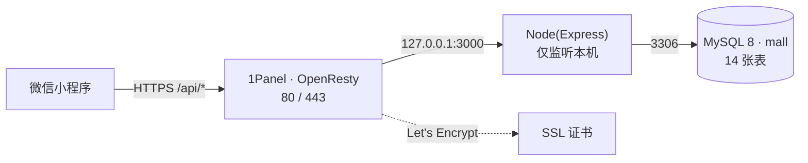

# 腾讯云 1Panel 部署手册（MySQL + Node + OpenResty）

把本项目部署到**自己的腾讯云服务器**，由 **1Panel** 统一管理 MySQL、Node 服务、反向代理与证书。

> 阅读前提：本地已能跑通 `npm run dev` + `npm run smoke`。本地开发步骤见 [README](./README.md)。

---

## 0. 部署形态与最终架构



安全边界：

| 端口 | 是否对外 | 说明 |
|---|---|---|
| 22 | 放行 | SSH（建议限制来源 IP） |
| 80 / 443 | 放行 | OpenResty，唯一入口 |
| 3000 | **不放行** | Node 只监听 `127.0.0.1` |
| 3306 | **不放行** | MySQL 只被本机 Node 访问 |

---

## 1. 前置准备

### 1.1 服务器

- 腾讯云 CVM 或轻量应用服务器，建议 **2 核 4G** 起，Ubuntu 22.04 / Debian 12。
- 系统盘 ≥ 40G（数据库 + 代码 + 备份）。
- 云服务器安全组 / 防火墙放行 `22`、`80`、`443`。**不要**放行 `3306`、`3000`。

### 1.2 域名（关键前置）

> **域名备案是本项目上线最长的路径，建议第一天就提交。**

- 小程序正式环境的 `request 合法域名` 必须是「**已备案域名 + HTTPS**」，且域名需在小程序后台配置，没有变通空间。
- 腾讯云境内服务器上，**未备案域名的 80/443 访问会被拦截**：这意味着备案完成前，Let's Encrypt 的 HTTP-01 校验也无法通过。
- 结论：**先把代码与数据库部好（本手册 2~9 节），用 IP + 开发者工具调试；备案通过后再做第 10~12 节。**

ICP 备案大致流程（腾讯云控制台 → 备案）：

1. 域名完成**实名认证**（约 1~3 天，与备案是两件事）；
2. 服务器需为腾讯云、且**购买时长 ≥ 3 个月**（轻量服务器同样支持）；
3. 提交主体与网站信息，腾讯云初审 1~2 天 → 管局审核约 1~20 个工作日；
4. 通过后域名可正常解析访问，并出现在工信部备案系统。

---

## 2. 安装 1Panel

在服务器终端执行（官方一键脚本，具体命令以 1Panel 官网为准）：

```bash
curl -sSL https://resource.fit2cloud.com/1panel/package/quick_start.sh -o quick_start.sh
sudo bash quick_start.sh
```

安装后可访问 `http://<服务器公网IP>:<面板端口>`。**随后立刻做的事**：

1. 面板 → 设置 → 修改**默认端口**与**安全入口**；
2. 绑定域名（备案后再做）并开启面板 HTTPS；
3. 面板 → 设置 → 快照，创建一份初始快照（回滚用）。

---

## 3. 安装并配置 MySQL 8

### 3.1 安装

1Panel → **应用商店** → 搜索 `MySQL` → 安装 **8.x**。

安装弹窗里注意两项：

- **端口**：默认 `3306`，映射到宿主机。记下实际映射端口（后面 `.env` 的 `DB_PORT` 要一致）。
- **root 密码**：安装时生成，务必保存到密码管理器。

> ⚠️ **最常见的坑**：1Panel 的 MySQL 是**容器化部署**。若「容器端口」没有映射到宿主机，宿主机上的 Node 连 `127.0.0.1:3306` 会失败。安装后在「容器 → 容器」里确认端口映射存在。

### 3.2 建库 + 建专用账号

面板 → **数据库** → `MySQL` 标签：

1. **创建数据库**：名称 `mall`，字符集 `utf8mb4`，排序 `utf8mb4_unicode_ci`；
2. **创建用户**：用户名如 `mall_app`，主机选**本地服务器 `localhost`**（不要选「所有人」，避免公网可连），生成强密码；
3. 回到数据库列表，把 `mall` 的**权限**授予 `mall_app`。

> `sql/schema.sql` 里带 `CREATE DATABASE IF NOT EXISTS mall`，即使跳过第 1 步，`npm run db:init` 也会自动建库；但**专用账号必须提前建好并授权**，生产环境不要用 root 跑应用。

若希望手动执行 SQL：

```bash
mysql -h 127.0.0.1 -P <映射端口> -u mall_app -p mall < sql/schema.sql
```

---

## 4. 上传代码

任选一种（**只需 `server/` 目录**，小程序端不需要上传）：

**A. Git（推荐，便于后续更新）**

```bash
cd /opt
git clone <你的仓库地址> wxapp
cd wxapp/server
```

**B. 1Panel 文件管理**

面板 → 文件 → 在 `/opt` 下新建 `wxapp/server` → 上传 `server/` 的压缩包 → 解压。

> 不要把 `node_modules` 传上去，在服务器上装。

**排除文件**：`.env`（本机配置，不要覆盖）、`.tmp-*`、`node_modules`。

---

## 5. 配置生产环境变量

```bash
cd /opt/wxapp/server
cp .env.example .env
```

编辑 `.env`（1Panel 文件管理器可直接在线编辑）。生产必须修改的项：

| 变量 | 生产取值 | 说明 |
|---|---|---|
| `HOST` | `127.0.0.1` | **必须**，Node 不对外暴露 |
| `PORT` | `3000` | 与反向代理配置一致即可 |
| `DB_HOST` | `127.0.0.1` | 见下方「两种形态」 |
| `DB_PORT` | MySQL 映射端口 | 与 3.1 记录的一致 |
| `DB_USER` | `mall_app` | **不要用 root** |
| `DB_PASSWORD` | 强密码 | 3.2 生成 |
| `DB_NAME` | `mall` | |
| `JWT_SECRET` | 随机长串 | 见下 |
| `ADMIN_PORT` | `3001` | 管理后台端口（独立进程） |
| `ADMIN_JWT_SECRET` | 另一串随机长串 | 与 JWT_SECRET 不同 |
| `ALLOW_MOCK_LOGIN` | `false` | 生产必须关闭 |
| `WECHAT_APPSECRET` | 真实值 | 小程序后台获取 |

生成 `JWT_SECRET`：

```bash
node -e "console.log(require('crypto').randomBytes(48).toString('hex'))"
```

### ⚠️ 两种 DB 连接形态，不要混用

| 形态 | 适用 | `DB_HOST` |
|---|---|---|
| MySQL 在容器、Node 在**宿主机** | 最省事，推荐 | `127.0.0.1`（依赖容器端口映射） |
| MySQL 与 Node **都在容器** | 都用 1Panel 编排时 | 1Panel 网络内的 **MySQL 容器名**（如 `mysql`），`DB_PORT=3306` |

`.env` 与 `.gitignore` 都不要入库；生产密钥只存在于服务器。

---

## 6. 安装依赖并初始化数据

```bash
cd /opt/wxapp/server
npm ci --omit=dev          # 只装生产依赖
npm run db:init            # 建库建表(15 张表,含 admins,可重复执行)
npm run db:seed            # 灌入 4 分类 / 14 商品 / 42 张图 / 70 个规格 / 3 轮播
```

**已有真实数据的库不要用 `db:init`**（它会 DROP + CREATE 重建全部表）。改用增量迁移，它只加列、加表，并自动跳过已存在的对象：

```bash
npm run db:migrate
```

`db:seed` 是幂等的：先 `TRUNCATE` 再插入，**`users` / `addresses` 不会被清空**，重复执行结果完全一致。

---

## 7. 在 1Panel 上跑 Node 服务

### 方式 A：1Panel 图形化「Node 项目」（推荐）

面板 → **网站 → Node 项目**（不同版本可能在「运行环境」下）：

- **名称**：`huawei-mall-api`
- **目录**：`/opt/wxapp/server`
- **启动命令**：`node src/app.js`（或 `npm start`）
- **端口**：`3000`
- **Node 版本**：**≥ 18**（1Panel → 应用商店 → `Node.js` 版本管理，先装一个 18/20 的版本）
- **运行用户**：非 root 用户更安全

创建后 1Panel 会自动生成 OpenResty 反向代理，并可配置开机自启与日志。

### 方式 B：PM2 + OpenResty 手动反代

```bash
npm i -g pm2
cd /opt/wxapp/server
pm2 start src/app.js --name mall-api
pm2 startup && pm2 save        # 开机自启
pm2 logs mall-api              # 看日志
```

然后在 1Panel → **网站** → 创建**反向代理**网站，指向 `http://127.0.0.1:3000`。

### 验证服务本身

```bash
curl http://127.0.0.1:3000/api/health
# {"ok":true,...}
```

服务日志里应出现 `listening on http://127.0.0.1:3000 (bind 127.0.0.1)`。

### 7.3 管理后台（独立进程，必跑第二个 Node 项目）

管理后台是与小程序 API **完全独立**的 Node 进程（端口 3001），复用同一个 `.env` 与数据库：

```bash
cd /opt/wxapp/server
npm run admin:start        # 前台试跑
# 1Panel 方式 A:新建「Node 项目」,启动文件填 admin/app.js,端口 3001
# PM2 方式 B:
pm2 start admin/app.js --name mall-admin
```

验证：`curl http://127.0.0.1:3001/admin/api/health` → `{"ok":true,"service":"mall-admin"}`

浏览器访问 `http://127.0.0.1:3001/admin`，默认账号 **admin / admin123**（`db:seed` 自动创建），**登录后立即在右上角修改密码**。

对外访问（备案完成后）两种方式二选一：

1. **子域名反代（推荐）**：新建网站 `admin.你的域名` → 反向代理到 `http://127.0.0.1:3001`，照常上 HTTPS；
2. **路径反代**：现有站点加一条 `location /admin/ { proxy_pass http://127.0.0.1:3001; }`。

⚠️ 安全要求：管理端 `ADMIN_HOST` 保持 `127.0.0.1`，永远不要直接暴露 3001；`ADMIN_JWT_SECRET` 必须换成与 `JWT_SECRET` 不同的随机长串。

---

## 8. 反向代理与域名

面板 → **网站** → 你的站点 → **反向代理**：

```
代理地址: http://127.0.0.1:3000
```

要点：

- **保留 `/api` 前缀**（小程序端 `API_BASE_URL` 形如 `https://域名/api`），因此**不要**开「去除前缀」；
- 若站点根路径已被占用，可把位置设为 `/api`，代理到 `http://127.0.0.1:3000/api`；
- 打开 WebSocket / 长连接开关对本项目无影响，保持默认即可。

建议的 Nginx 片段（1Panel 生成后如需微调）：

```nginx
location /api/ {
    proxy_pass http://127.0.0.1:3000;
    proxy_http_version 1.1;
    proxy_set_header Host $host;
    proxy_set_header X-Real-IP $remote_addr;
    proxy_set_header X-Forwarded-For $proxy_add_x_forwarded_for;
    proxy_set_header X-Forwarded-Proto $scheme;
}
```

---

## 9. HTTPS 证书

> **前提：域名已备案并通过。** 未备案时境内服务器的 80/443 会被拦截，HTTP-01 校验会失败。

面板 → **网站** → 你的站点 → **HTTPS**：

1. 选 **Let's Encrypt**，勾选域名，申请（自动续期）；
2. 或选「手动导入」上传你自己的证书（`.pem` + `.key`）；
3. 开启 **强制 HTTPS**。

域名解析：在腾讯云 DNS 添加 `A` 记录指向服务器公网 IP。

自检：

```bash
curl -I https://<你的域名>/api/health
# HTTP/2 200
```

---

## 10. 数据库备份

面板 → **计划任务** → 创建任务：

- **类型**：备份数据库（MySQL）
- **目标**：`mall`
- **执行周期**：每天凌晨 3 点（`0 3 * * *`）
- **保留份数**：7~30

再建议：面板 → 设置 → **快照**，或把备份目录同步到对象存储（1Panel 支持备份到腾讯云 COS）。

手工备份 / 恢复：

```bash
# 备份
mysqldump -h 127.0.0.1 -P <映射端口> -u mall_app -p mall > mall_$(date +%F).sql

# 恢复
mysql -h 127.0.0.1 -P <映射端口> -u mall_app -p mall < mall_2026-09-24.sql
```

---

## 11. 备案完成后：打通小程序

### 11.1 小程序后台配置

微信公众平台 → **开发 → 开发管理 → 开发设置 → 服务器域名**：

- **request 合法域名**：`https://<你的域名>`
- **downloadFile 合法域名**：`https://images.unsplash.com`（演示商品图是外链；迁到自有 CDN 后改成自己的域名）

### 11.2 小程序端切换到线上接口

编辑 `wxapp/frontend/services/config.js`：

```js
const API_BASE_URL_PROD = 'https://<你的域名>/api'   // ← 改成真实域名
const USE_PROD_API = true                            // ← 改为 true
const MANUAL_USE_MOCK = false                        // ← 后端就绪后关闭 mock
```

改完用**微信开发者工具重新编译**，真机预览验证。若配置里还是占位域名，控制台会出现
`[config] USE_PROD_API 已开启,但 API_BASE_URL_PROD 仍是占位域名` 的提醒。

### 11.3 端到端验证

```bash
cd /opt/wxapp/server
SMOKE_BASE=https://<你的域名>/api npm run smoke      # 线上跑 85 项断言
```

---

## 12. 备案期间的临时调试办法

备案通过前无法真机调用线上接口，用下面的方式把功能先验收完：

| 场景 | 做法 |
|---|---|
| 开发者工具调本机后端 | 详情 → 本地设置 → 勾选 **不校验合法域名、web-view、TLS 版本以及 HTTPS 证书**；`services/config.js` 保持 `http://127.0.0.1:3000/api` |
| 真机预览调服务器后端 | 服务器 `.env` 临时 `HOST=0.0.0.0`，安全组临时放行 `3000`，`API_BASE_URL` 改为 `http://<公网IP>:3000/api`；**验收完立刻改回并关闭端口** |
| 只看 UI 不看数据 | `services/config.js` 里 `MANUAL_USE_MOCK = true`，全部走本地 mock |

> IP 直连只用于调试，小程序正式环境不接受 IP。

---

## 13. 常见故障排查

| 现象 | 原因与处理 |
|---|---|
| 启动即报 `ER_ACCESS_DENIED_ERROR` | `.env` 的 `DB_USER` / `DB_PASSWORD` 与 3.2 创建的不一致；或该账号未获得 `mall` 授权 |
| `ECONNREFUSED 127.0.0.1:3306` | MySQL 容器**端口未映射到宿主机**；到「容器 → 容器」确认映射，或改用「Node 也在容器」形态并把 `DB_HOST` 换成容器名 |
| `EADDRINUSE: 3000` | 端口被占用：`ss -lntp \| grep 3000`；改 `.env` 的 `PORT` 并同步反向代理 |
| 反向代理 502 | Node 没起来或监听地址不对：`curl http://127.0.0.1:3000/api/health` 自检；确认 `.env` 的 `HOST=127.0.0.1` |
| 小程序报「不在以下 request 合法域名列表中」 | 域名未加入后台白名单 / 未用 HTTPS / 域名未备案；备案期请用第 12 节办法 |
| 商品图不显示 | `images.unsplash.com` 未加入 **downloadFile 合法域名**，或网络不可达；建议把图迁到自有 CDN |
| 接口 401 且前端被登出 | 正常行为：token 过期或账号被禁用（`users.status = 0`）；重新登录即可 |
| 下单报「库存不足」 | 正常业务拦截：`products.stock` / `product_skus.stock` 不足；取消订单会自动回补库存 |
| 改了 `sql/schema.sql` 但服务器没变 | 重新执行 `npm run db:init`（会清数据）或写一个 `sql/migrations/00X_*.sql` 后跑 `npm run db:migrate` |
| 忘记 root 密码 | 面板 → 数据库 → MySQL → 修改密码；或从「容器 → 终端」进入重置 |

---

## 14. 上线 checklist

- [ ] 安全组仅放行 `22` / `80` / `443`
- [ ] `.env` 的 `HOST=127.0.0.1`，`ALLOW_MOCK_LOGIN=false`
- [ ] `JWT_SECRET` 已替换为随机长串
- [ ] `DB_USER` 使用专用账号 `mall_app`，非 root
- [ ] `npm ci --omit=dev` 安装生产依赖
- [ ] `npm run db:init` + `npm run db:seed`（或对已有数据的库执行 `npm run db:migrate`）
- [ ] Node 服务已设为开机自启（1Panel Node 项目 / `pm2 startup`）
- [ ] 反向代理指向 `http://127.0.0.1:3000` 且保留 `/api` 前缀
- [ ] HTTPS 证书已签发并开启强制跳转
- [ ] 数据库定时备份任务已创建
- [ ] 域名已备案，小程序后台已配置 request / downloadFile 合法域名
- [ ] 前端 `services/config.js` 的 `USE_PROD_API = true` 且域名正确
- [ ] 线上 `SMOKE_BASE=https://<域名>/api npm run smoke` 全绿

---

## 附：本手册涉及的项目脚本

| 命令 | 作用 |
|---|---|
| `npm run db:init` | 全量建库建表（15 张表），可重复执行，会清空业务数据 |
| `npm run db:migrate` | 增量迁移 `sql/migrations/*.sql`，保留已有数据，自动跳过已存在的列/索引 |
| `npm run db:seed` | 从 `frontend/mock/` 灌入演示数据并初始化默认管理员，幂等，保留 `users` / `addresses` |
| `npm run smoke` | 85 项后端端到端断言 |
| `npm run smoke:admin` | 47 项管理后台端到端断言（需两个服务都在跑） |
| `npm start` / `npm run dev` | 小程序 API 生产启动 / 开发热重载 |
| `npm run admin:start` / `admin:dev` | **管理后台**生产启动 / 开发热重载（端口 3001） |
| `npm run mysql:*` | 仅本机开发用的独立 MySQL 实例，**上云不需要** |
